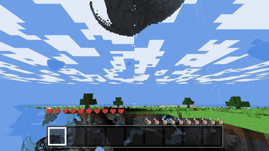

# Blockverse

A block-building sandbox that runs in a desktop browser tab: mine, craft and get through the night, then ride wind vents up to the islands floating over the world. No install, no account; worlds are saved in your browser.

**[Play it](https://appleweiping.github.io/blockverse/)** (desktop Chrome, Edge, Firefox or Safari 15+, keyboard and mouse)



*Real-time capture from the live game (seed `12345`, a few seconds of the climb cut out). Note the hearts: no fall damage after a glide.*

I built this to see how a voxel engine fits together (chunk streaming, flood-fill lighting, meshing with ambient occlusion) without a game engine doing it for me. The genre is obviously inspired by Minecraft; the code is my own, and every texture and sound is generated at runtime, so the game ships no image or audio files.

## What is different here: sky islands and wind vents

- Islands float 90 to 105 blocks up wherever a sparse noise field peaks: flat grassy tops with a few trees, and undersides of **skystone** that hang down like upside-down hills. Skystone gives off a faint light, so the undersides are not pitch black.
- A **wind vent** blows a column of air straight up for 72 blocks, or until something solid blocks it. Stand on one and you rise; hold Shift to sink back down; walk out of the column and you **glide** down slowly and take no fall damage until you land. Dropped items ride the column too.
- Natural vents sit on the ground right next to an island, with a ring of skystone around them so you can spot them from a distance. Once you have mined some skystone you can craft your own (4 skystone around an iron ingot, makes 2) and build elevators anywhere.

The rest is the usual survival loop: 9 biomes, caves and ores, tools with tiers and durability, a workbench and furnace, hunger, pigs and sheep, and murklings that come out in the dark and dig themselves back underground at sunrise.

## Run it locally

Needs Node.js 22 or newer.

```bash
git clone https://github.com/appleweiping/blockverse.git
cd blockverse
npm install
npm run dev        # http://localhost:5173
npm test           # 34 unit tests (node:test, no browser needed)
npm run build      # static site in dist/
```

The `main` branch deploys to GitHub Pages through [.github/workflows/deploy.yml](.github/workflows/deploy.yml).

## Controls

| Input | Action |
| --- | --- |
| WASD, mouse | Move, look (click the game to capture the mouse) |
| Left / right click | Mine or attack / place, use, eat |
| Space, Ctrl, Shift | Jump, sprint, sneak (in a wind column: sink) |
| E | Inventory and 2x2 crafting |
| 1-9, mouse wheel | Hotbar |
| T or / | Chat and commands (`/help`, `/tp`, `/time set noon`, `/give wind_vent 4`, `/mode creative`) |
| ` (backquote) | Debug overlay |

Phones and tablets get a notice first, because there are no touch controls. Everything else is in [docs/CONTROLS.md](docs/CONTROLS.md).

## Devlog

**Chunks and meshing.** The world is 16x128x16 chunks stored as flat `Uint16Array`s, indexed so that a vertical column is contiguous in memory (sky light and surface queries scan columns all the time). Terrain is generated in a pool of Web Workers and transferred back without copying. Meshing runs on the main thread under a per-frame time budget, nearest chunk first, and only emits faces next to non-opaque blocks. Each vertex carries its sky and block light already multiplied by ambient occlusion; the AO uses the usual three-neighbour rule, and I flip the quad diagonal when the corners disagree, because otherwise AO on a flat floor shows a diagonal crease. Textures are layers of a `DataArrayTexture` instead of one atlas image, which is what makes mipmapping work without neighbouring tiles bleeding into each other at a distance.

**Lighting.** Two 0-15 channels, sky and block, flood-filled with a BFS that crosses chunk borders. Sky light at 15 travels straight down without losing strength and loses one level per step sideways, so caves and the ground under an overhang go dark naturally. Changing a block runs a removal pass first (zero everything that was lit through the changed cell, and remember the brighter neighbours) and then refills from those neighbours. The fiddly part is chunk borders: a newly loaded chunk has to pull light in from neighbours that were lit earlier and also push its own light back out to them. The lighting code has no three.js dependency, so `test/light.test.js` builds small worlds in Node and checks exact light levels (torch falloff, two torches with one removed, a shaft dug down to a sealed room).

**Islands and wind.** Islands are a pure function of the column, so every chunk computes the same island without talking to its neighbours, the same trick that keeps trees from being cut at chunk borders. The lift is a downward scan from the entity's cell until it hits a vent (lift) or anything solid or liquid (no lift), fading out over the last six blocks so you bob at the top instead of stopping dead. Things that went wrong on the way: vents were placed on the edge band of the noise field, which also matched bumps that never grew into an island, so some vents blew into empty sky until I required an island column within 8 blocks; the cloud layer sat at y = 108, right between the island tops and the top of a wind column, so every ride ended in white fog until I moved it to 160; and a default parameter (`ground = this.heightAt(x, z)`) made every island lookup compute the terrain height even for columns with no island, which made chunk generation about 60% slower until I moved it after the early return.

More detail on the engine is in [docs/ARCHITECTURE.md](docs/ARCHITECTURE.md).

## Why not an existing voxel game?

[Luanti (formerly Minetest)](https://www.luanti.org/) and [ClassiCube](https://www.classicube.net/) are complete, much more capable games, and you should play them. Blockverse is for when you want something that opens in a browser tab, or want to read how the pieces fit together: about 7,400 lines of plain JavaScript with three.js and Vite as the only dependencies.

## Limits

- Desktop only (keyboard and mouse), and it needs WebGL 2. If WebGL 2 is not available, the game says so instead of showing a black screen.
- Water does not flow, there is no redstone-style logic and no multiplayer.
- Saves live in the browser's IndexedDB; clearing site data deletes them.
- Block and item ids never change, so worlds from older versions still load (chunks you had already edited will not grow islands).

## License

MIT, see [LICENSE](LICENSE). Not affiliated with Mojang or Microsoft.
